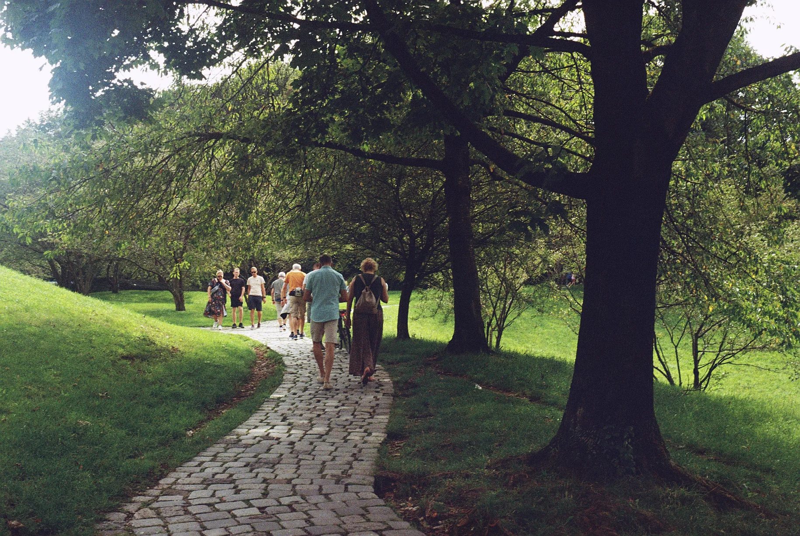
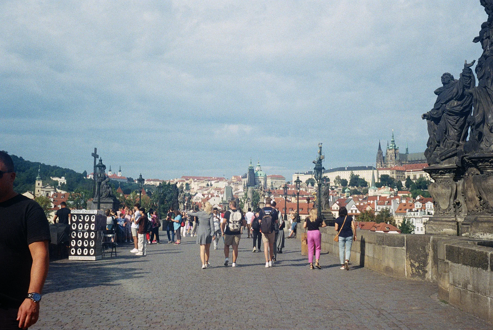
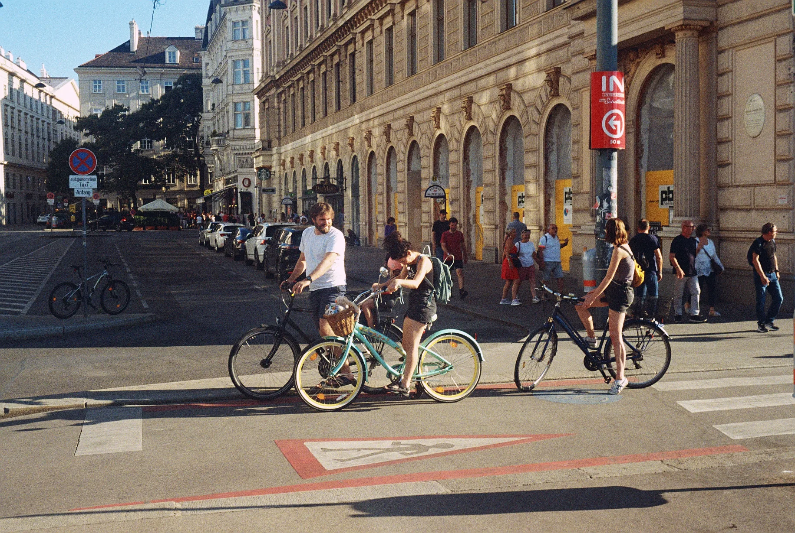
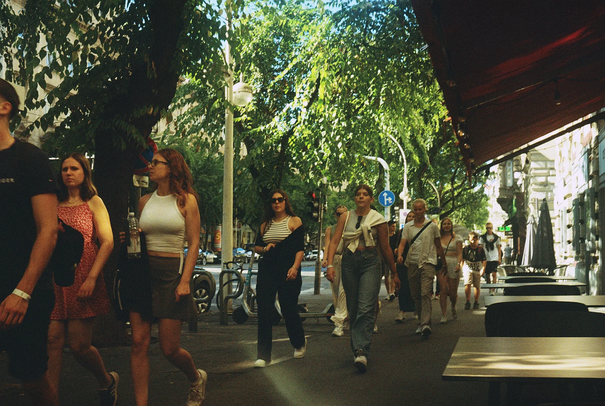

*One night in Bangkok and the world's your oyster*

### Part 1: Munich

September 1st: Arrived, found hostel, drank with some people, karaoke

2nd: BMW museum with Indian guy, learned card game, karaoke

3rd: Went to Olympus park alone, lazy day

4: German science museum (Deutsches Museum), learned other card games

5: Partied at hostel, Irish pub, dance club with Mia and Isabella, spent too much money

6: Laundry, slept, traveled to fathers house

7: Pilgrimage day 1, slept on farm

8: Pilgrimage day 2, got to Church of Our Lady Altötting, Germany, could not walk at end, limped everywhere

9: Summer fest with church

10: Church, let feet heal (were full of blisters from Pilgrimage)

### Part 2: Prague

11: Traveled to Prague

12: Prague National museum - Praha - Národní muzeum

13: Walked around Prague castle, took 35mm photos, drank with some polish people and smoked hookah

14: Hostel booked for Vienna, train booked, Last night in Prague

### Part 3: Vienna

15: Train to Vienna, was with two French chicks, one was a midwife, the other a doctor. Asked them some questions about birth, but stopped because I was embarrassed. Went to hostel bar, met a few people, went to a club, felt guilty after because I spent about 100 euros during the night.

16: Was sad about spending so much the night before so I stayed in bed until 2 the next day. Went to common area around 6. Netherlands girl (berberrrtje) sat next to me, 4 others joined (Canadian Girl, Australian that had been traveling 7 months). Started drinking around 9, went to bed around 1. Met the same people from the night before.

17: Wandered Vienna, took pictures, drank about 4 beers that night, won pool for the 3rd night in a row

18: Made travel reservations during the day, at night wandered for a few hours, found a chess club by the side of a subway, played against a New Yorker who kicked my butt (in chess).

### Part 4: Budapest

19: Traveled to Budapest, ate some weird fried pizza called a Lagos, didn't like it. Played pool with some pros, played werewolf with some ceramics students

20: Took pictures of women with my 35mm camera all day, looked at backpacks since the strap on mine broke, tried to play pool with some random, some gypsies tried to sell me a (lady), saw some girls I met in Vienna (Mia and Isabella) went to a German bar, met a girl and two guys, played chess with one of them, he had his own board and I lost,  girl wrote “do you want me to get them to leave?” On a piece of paper. Two more (ladies) tried to get with me.

21: Walked around around the city and took photos during the day. Ate cheaply. Didn’t drink because I had so much the night before.

22: Went to cafe_Analóg and developed my 3 rolls of film. At night drank with like 3 groups of people in the ruins bar. At the end of the night they started kissing and I felt singled out, lonely and depressed.

23: Didn’t feel like doing anything but my roommates invited me to the hot baths. It was super relaxing. Switching between the hottest and coldest bath felt great. Went to the rooftop bath and fell asleep in it. Breathtaking view. Afterwards we went to a fancy restaurant.

24: About ready to go home, just spent the day eating at restaurants and cafes before my overnight bus trip back to Munich

25: Got to the hotel, slept for an hour, ate at durum with some German guys, went to the Wombat hostel for one more night

26: Plane back at 10am

