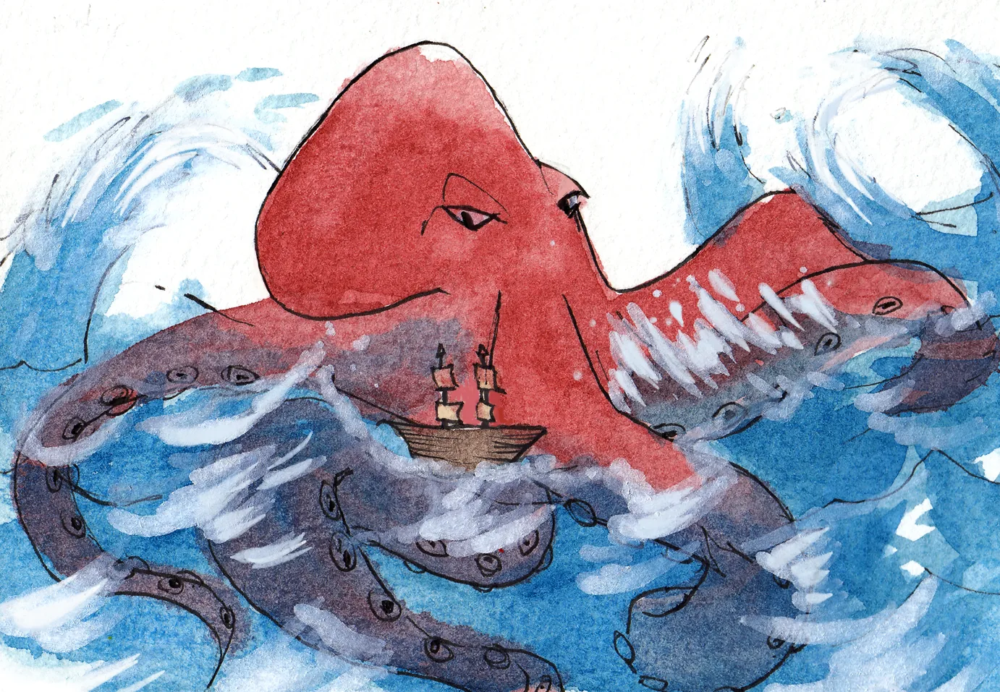
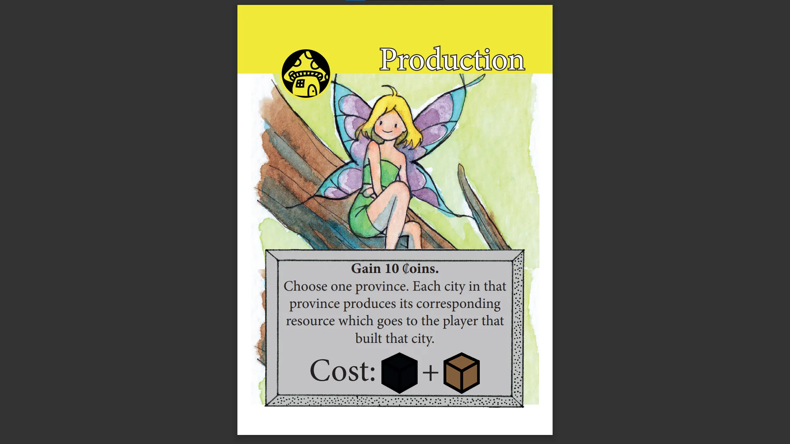
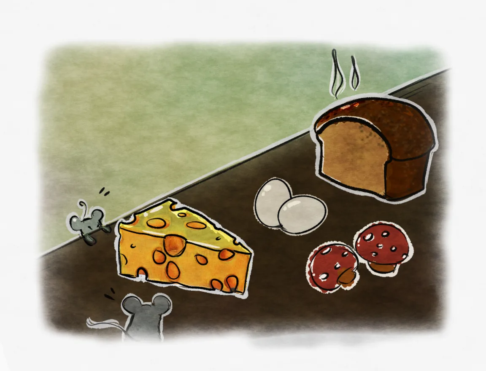

*Embark on a journey behind the scenes of Gorbino's Quest and explore the meticulous process of designing captivating cards.*

### Acquiring Artistic Brilliance

To breathe life into Gorbino's Quest, I scoured Reddit's Starving Artist forum, a haven for creative minds. Initially drawn to the enchanting watercolors of Shawnasaur ([Instagram](https://www.instagram.com/shawnasaur/)), budget constraints led me to discover the exceptional talents of Amanda Corona ([Instagram](https://www.instagram.com/sanagie/)) and Artistic Yomii ([ArtStation](https://afkyomii.artstation.com/)). Over a few weeks, these artists masterfully crafted 48 pieces of art, bringing the game to life.

### Crafting Card Perfection

PandaGM recommended Adobe InDesign for finalizing card files. Despite a fleeting attempt to circumvent Adobe's subscription fees, I ultimately succumbed and subscribed for a brief period. InDesign proved to be an intuitive and enjoyable tool, culminating in a satisfying design for all the cards. Here's a glimpse of one:

### Charting the Course Ahead

As I prepare for the Kickstarter launch, a 'ToDo' list becomes my guiding star. Here's a snapshot of the essential tasks:

Next Steps Checklist

1. Create BGG page
2. Finalize board with help of artist
3. Finalize box art with help of artist
4. Finalize punchboard art
5. Use blender to render box art
6. Finalize Kickstarter page details
7. Create a beautiful graphics for KS page
8. Setup banking details
9. Launch Kickstarter

Maybe Should Do List

- Find free reviewers for game
- Find paid reviewers for game
- Advertise
- Play test a few more times and tweak rules

With these lists in hand, I'm ready to navigate the exciting path ahead, ensuring Gorbino's Quest receives the attention it deserves. Stay tuned for more updates on this epic adventure!

