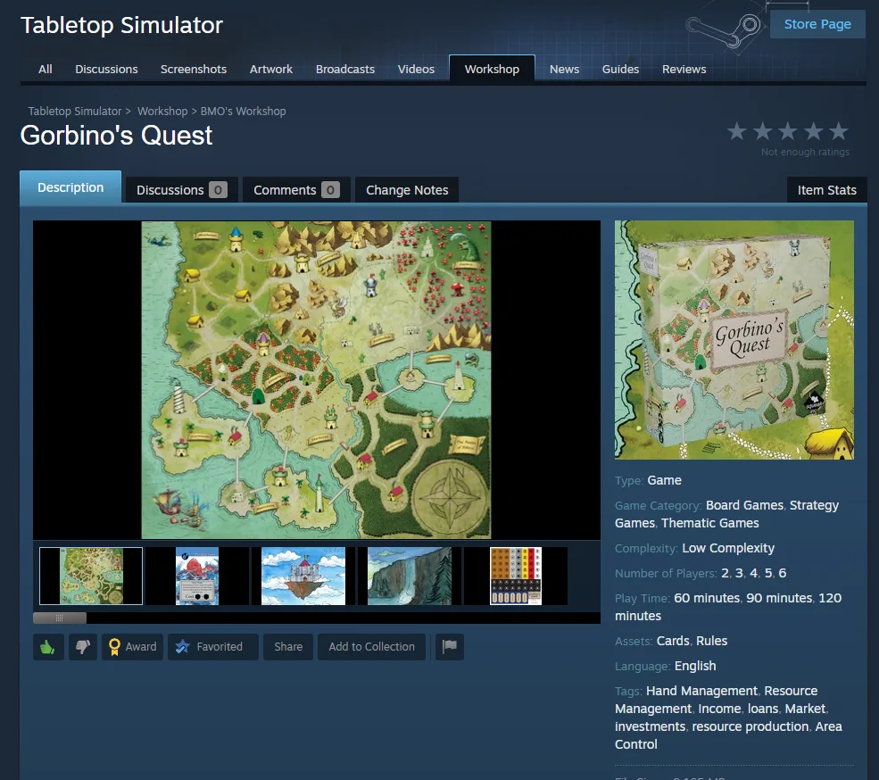

*Play Gorbino's Quest on Tabletop Simulator today & thoughts on relaunch*

### Tabletop Simulator

[🔗 TableTop Simulator](https://steamcommunity.com/sharedfiles/filedetails/?id=3111792472)

### Failed Kickstarter and Plans for a Relaunch

I initiated a Kickstarter campaign with an ambitious goal of $49,000, but the experience revealed areas that still require refinement in Gorbino's Quest. Looking ahead, I am considering a relaunch, tentatively scheduled for January, with a more modest funding target. The plan is to distribute additional copies through platforms such as Amazon or other board game websites. Despite the challenges encountered during the board game development process, I remain committed to the project. Recently, a new game concept, tentatively titled **Spirit Bath House**, took shape. Inspired by the bathhouse in Spirited Away, this game will feature worker placement mechanics with influences from Viticulture and Caylus. Players will be tasked with giving the correct baths to spirits, potentially involving the creation of specific bath tokens using various resources. Additionally, the game will incorporate the construction of buildings that other players can utilize, akin to Caylus. One of the primary actions will involve fulfilling orders with bath tokens, resembling the mechanics found in Viticulture. While I'm enthusiastic about this new idea, I plan to keep it on the back burner until Gorbino's Quest reaches completion.
