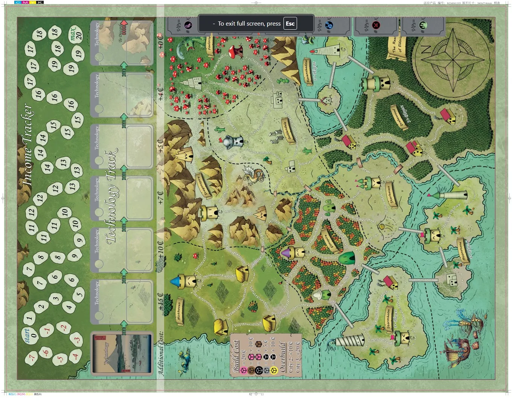
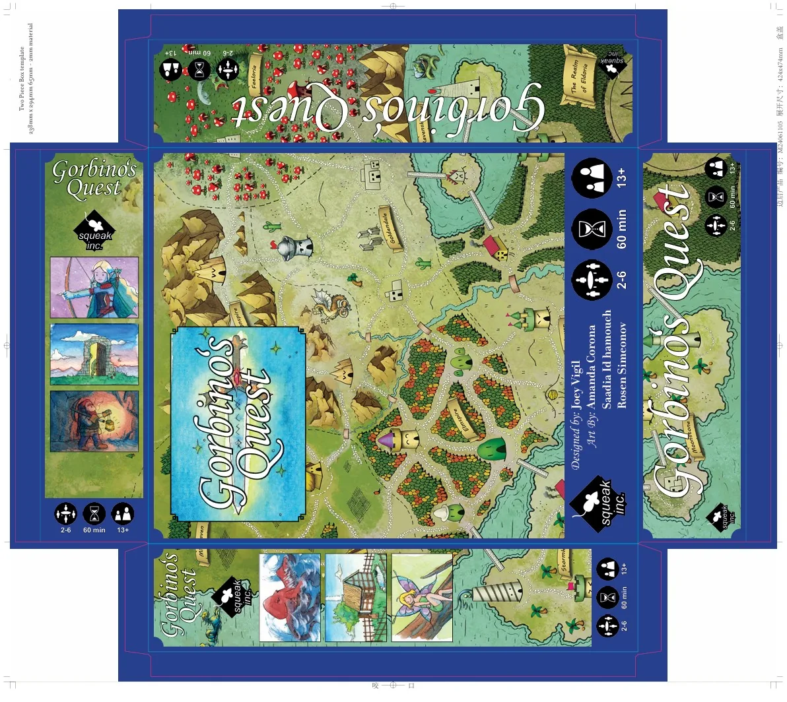
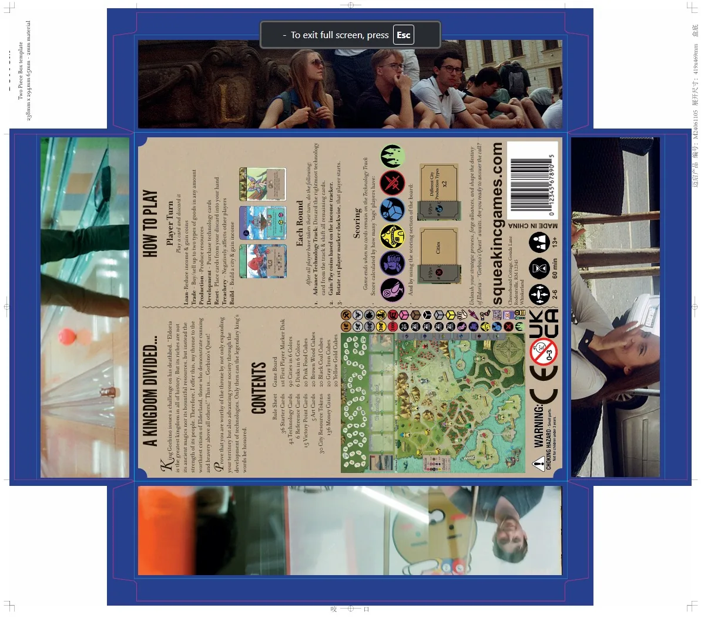
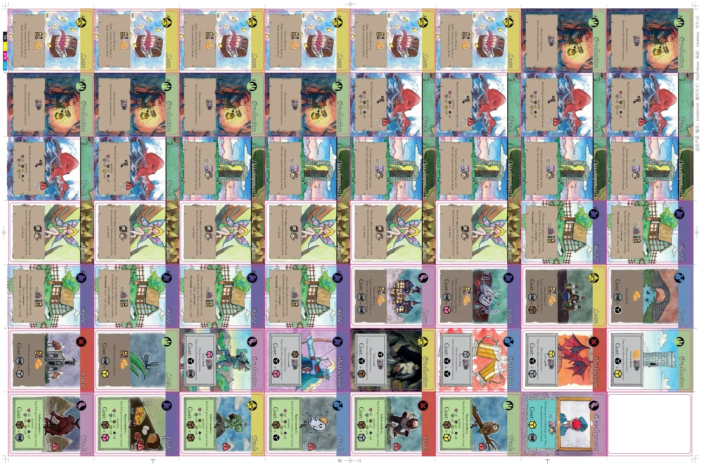
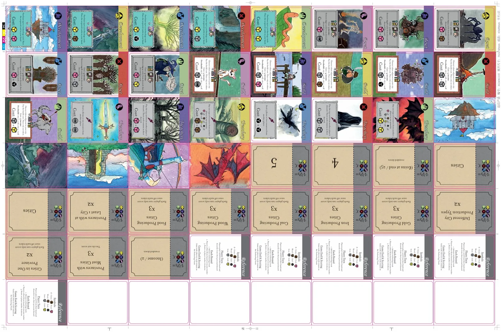
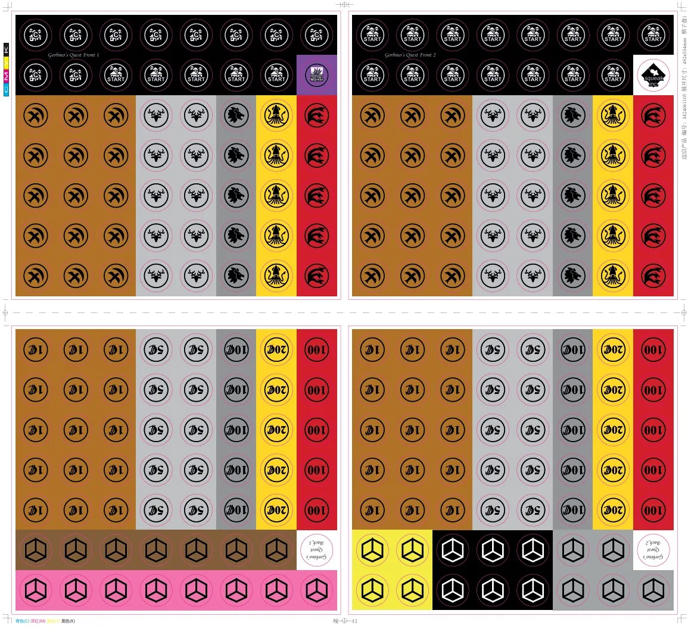
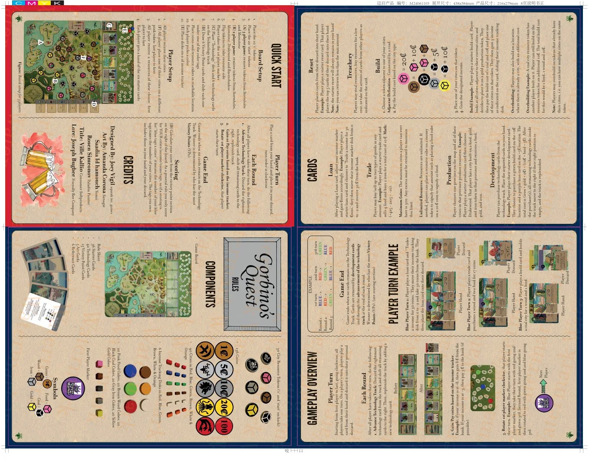
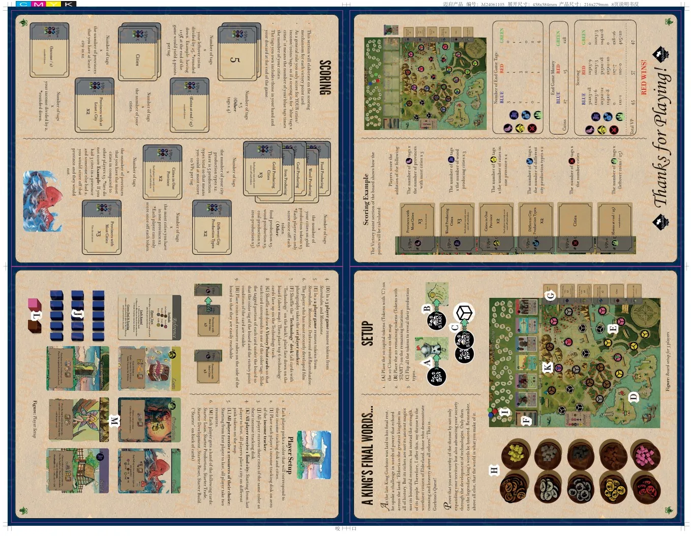

*"Daddy, what do taxes pay for?" "Why, everything! Policemen, trees, sunshine-- and let's not forget the folks who just don't feel like working, God bless 'em!"*

### Next Steps

We've made incredible progress this past year and are finally ready to relaunch in late August or early September. The files have been sent to Magicraft, and I have approved the e-proofs. I'll attach these below, though the final versions will include some minor changes, such as adding more cards to fill the pages and updating the rules and box to reflect these additions.

### Reviewers and Ads

So far, we have one confirmed influencer, BoardGameTikTok, recommended by Joe and Friendly Bee Company. He has a significant following and will be a great asset to our campaign. However, I believe we need a second paid reviewer and possibly one or two free ones. The campaign will run throughout September, with the BoardGameTikTok video being released at launch and the second reviewer's video being released as soon as possible afterward. Given the time it can take to produce these videos, it might be the end of September before it's ready. Although I don't want to run ads, it's a possibility. If we do, we will feature BoardGameTikTok's video.

### Board

### Box

### Cards

### Punchboard

### Rulebook

