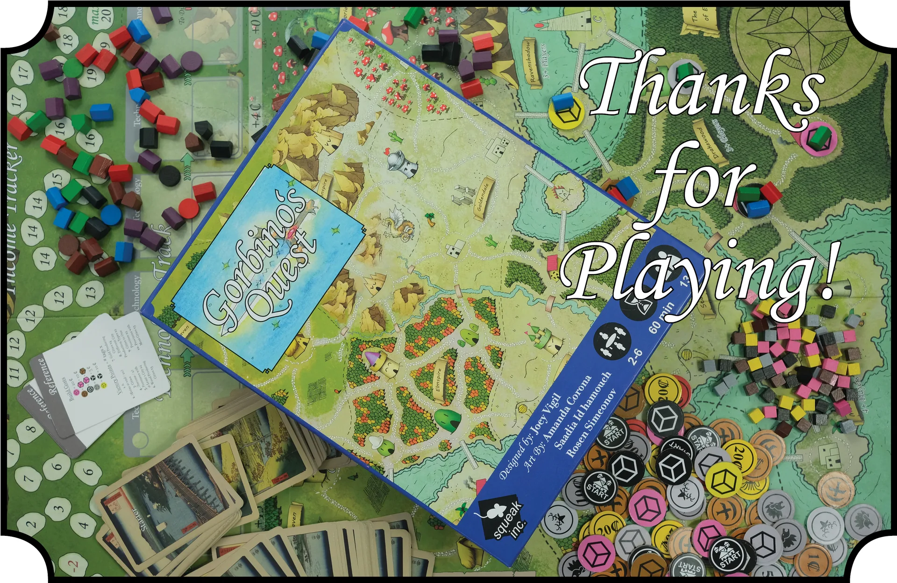
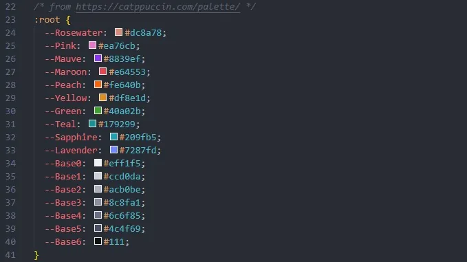
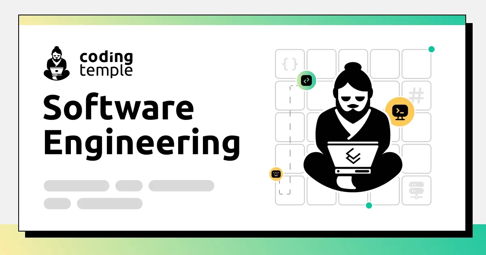

*Oh look what the cat dragged in...*

### RIP Gorbino’s Quest

Hey, it’s been a while. Sadly, Gorbino’s Quest didn’t meet its Kickstarter goal. I don’t think it will ever see the light of day, but I still want to design games in the future.

I’ve been tinkering with a train game inspired by Silverton, currently titled Rust. Only time will tell if it grows into a full project or ends up in the ever-growing “abandoned ideas” pile.

### style.css

If things look a little different around here, that’s because I added the Catppuccin color palette to the site. It brings a lot more vibrancy while also tying everything together with a consistent look.

### Coding Temple

Unfortunately—or maybe fortunately, depending on how you look at it—it’s time to “get a real job.” After a string of failed interviews and plenty of ghosting (a familiar story for anyone job-hunting in today’s economy), I signed up for a coding bootcamp called Coding Temple.

Back in 2020, I went through a different bootcamp, Revature. That led to a role at Infosys, where I was contracted to Nike to work on their warehouse management system. I spent about a year and a half there before moving back home. With some savings and free time, I dove headfirst into board games and board game design—that’s how Gorbino’s Quest came to be.

Fast forward to today, and I’m cruising through the Coding Temple curriculum thanks to my prior experience. Fingers crossed it leads to a fulfilling career.

