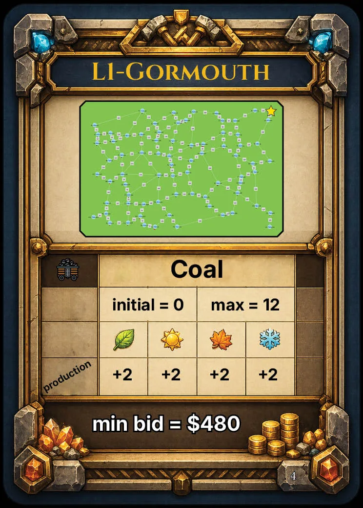
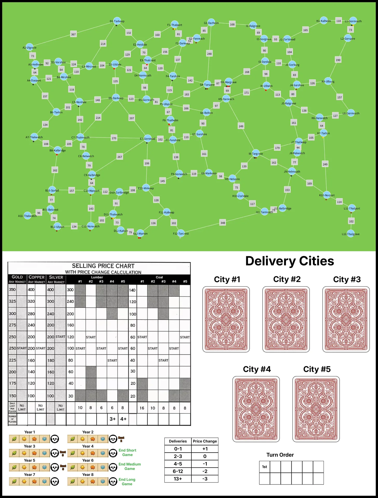

*"If there's nothing wrong with me... maybe there's something wrong with the universe." - Doctor Beverly Crusher*

This past week, I designed a new game titled Rust. The current version is completely unplaytested, so I’m sure there’s still a lot that needs to be adjusted and tweaked. That said, I’ve gotten to the point where I can usually tell if a game will at least function on a basic level.

The first game I ever designed was called *Settlers of the Cosmos*. It was supposed to be Cosmic Encounter, but with a map and resources. Needless to say, it was completely busted and barely functioned. My second game, Gorbino’s Quest, actually worked, but it had problems of its own — mainly that games could last around four hours. Over time, though, I managed to refine it into something I was genuinely proud of.

RIP Gorbino’s Quest. It’s still disappointing that I couldn’t get it published or run a successful Kickstarter for it.

### Where Rust Is — And Where It Needs to Go

Right now, I have a board that includes a map, stock market, season tracker, and a few other systems. I’ve made 50 mine cards, 52 train cards across seven train types, some tokens, a rough prototype box, and a set of reference cards that roughly contain the rules. I also uploaded everything to Tabletop Simulator.

The next step is getting playtests in and seeing if the game actually works. I need to adjust costs, rebalance the stock market, tweak how stock values change, and probably rework a few other systems as well. I’m also considering making a larger version of the game with 100+ mines and a corresponding expanded map.

I also need to think about whether the stock market should behave differently depending on player count. Honestly, after typing all this out, I can already see there’s still a lot that needs tweaking.

Once the gameplay reaches a good place, I can hire a map artist and graphic designer to make everything look professional.

After that, I could start building interest for a Kickstarter campaign. Maybe I’d run ads, attend conventions, and hand out business cards with links to a pre-launch page. Marketing and drawing attention to my games has always been the part I struggle with most.

Then, after all of that — and ideally after building a decent following for the pre-launch page — I could finally launch the Kickstarter. Of course, I’d still need to actually make the Kickstarter page too.

I think that’s the plan, anyway. But who knows if I’ll even want to go through with publishing it. It’s a lot of work.

