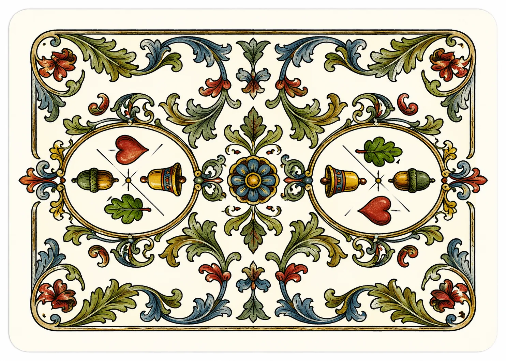
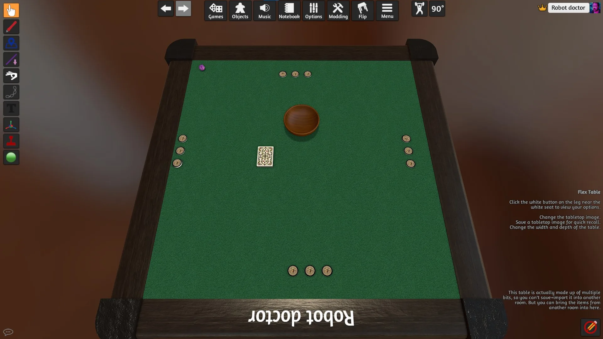

*"The secret, I don't know... I guess you've just gotta find something you love to do and then... do it for the rest of your life. For me, it's going to Rushmore." — Max Fisher, Rushmore (1998)*

### Why 31 Blitz?

Just for the record: I didn't design this game.

In fact, it isn't particularly popular on BGG. The prototype cards were generated with ChatGPT. So what exactly am I contributing here?

Mostly, I'm curating, refining, and sharing a game that I think deserves more attention.

I first played 31 Blitz with a group of Austrians in a hostel bar a few years ago. During that trip, I spent a surprising amount of time playing card games in hostel bars. Looking back, it's funny how universal that experience seems to be: card games, pool, and conversations with complete strangers.

Because of that experience, I was surprised to see that 31 Blitz wasn't rated more highly on BGG. I had a great time with it and kept thinking about it years later. I've been looking for a small-box card game project, and this feels like a perfect fit—especially if I can pair it with high-quality card art, a nice box, and, if everything goes according to plan, metal coins.

### What Did I Do?

The first thing I needed was a good-looking deck.

For the prototype, I used ChatGPT to help generate artwork. Before anyone panics, this isn't production artwork—it's strictly for prototyping.

I started with a simple prompt:

I want some images of German-suited playing cards for a new card game I'm designing. Help me create a prompt to create them. If possible I want it to generate 36 images for the card faces as well as a card back.

After a few rounds of follow-up questions and refinements, I ended up with a surprisingly solid prompt. I opened a new chat, generated the images, and was impressed by the results.

There were a few inconsistencies. For example, the face cards didn't include suit symbols, so I had to add those manually in InDesign. I also generated a card back and a coin design. Once everything was assembled, the prototype started to look surprisingly professional.

### Rules

I already had a working rule sheet, but I felt there was room for improvement.

So yes—I fed it into ChatGPT and asked for editing suggestions. I reviewed the feedback, kept what I liked, ignored what I didn't, and gradually refined the rules.

Eventually, I asked it to make the rules "more compact and easier to understand," which is something I think many modern rulebooks could improve.

A few weeks ago, I played a game called **Animal Kingdom** at a gaming convention in Cheyenne. One section explained how to resolve a tie in an area-majority contest. The rule itself was incredibly simple: each player reveals a card, the highest card wins, and a 1 beats an 8. Yet that explanation somehow stretched across an entire page.

Why?

Another example is **1846: The Race for the Midwest** (2005). To be fair, it's a complex game. But the rulebook consists of 24 pages of dense text with very few illustrations. Surely there are better ways to teach a game than asking players to work through a miniature textbook.

Good rules don't just explain a game—they teach it efficiently.

That's the philosophy I tried to follow while editing 31 Blitz. The goal wasn't to change the game, but to make learning it as painless as possible. I think the final rule sheet turned out excellent.

### Tabletop Simulator

I also created a Tabletop Simulator version of the game.

There isn't much to say about that process. I exported the card sheets, uploaded everything into a table, added the coins, and made sure the game was playable online.

Simple, but effective.

